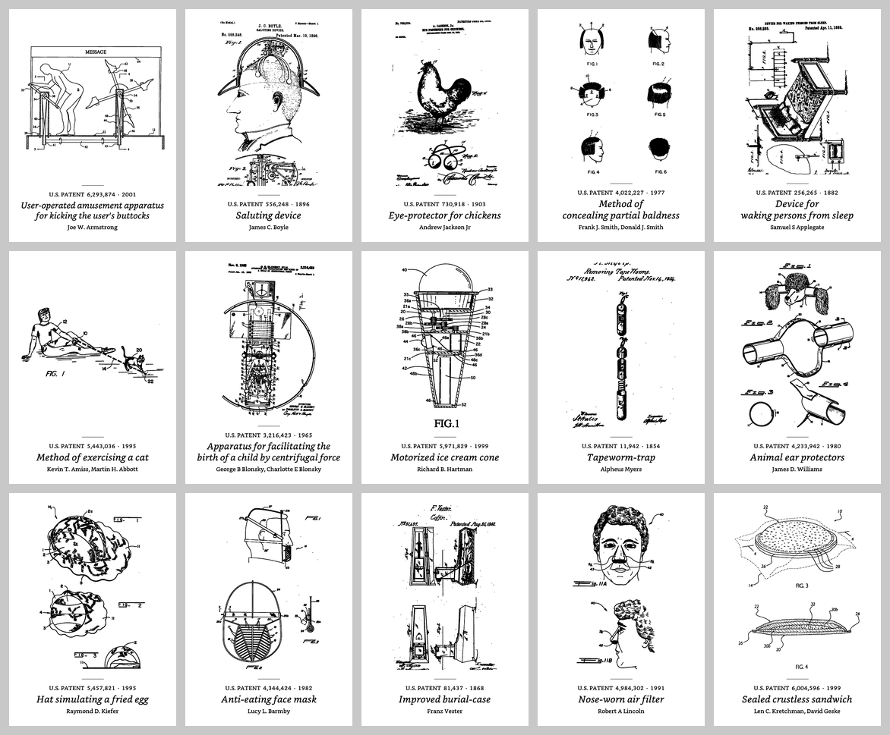

# Patent Wallpapers

Odd, funny, and quirky U.S. patent drawings, formatted as sleep screens for the
**Eegoread A4** e-reader running CrossPoint.



## Target format

| | |
|---|---|
| Screen | 3.98" E Ink, UC8279C controller |
| Resolution | **552 × 768** portrait (panel is 768 × 552 native, 238 PPI) |
| Gray levels | 4 (2 bits per pixel), so images are pre-quantized to 0 / 85 / 170 / 255 |
| File | **2-bit BMP**, 4-entry palette, exactly 552 × 768 |

CrossPoint shows a sleep image directly only when it is exactly screen-sized
and 2 bits per pixel or less. Anything else goes through its converter
(`BmpToBmpConverter`), which Atkinson-dithers with X4-tuned thresholds: below 45
is black, below 70 dark gray, below 140 light gray, and the rest white. That
lightens mid-grays, so anti-aliased text turns wispy. This applies even to
8-bit files whose pixels already sit on the 4 levels.

So the device set is written as true 2-bit files (`output/2bpp/`), which the
device shows pixel-for-pixel.

Each wallpaper also gets a full-grayscale reference PNG with the same layout
scaled to 2000 px tall (`output/gray-2000/`). Set `reference_height` in
`[device]` to change that height.

## Install on the device

1. Copy the BMPs to a `.sleep` folder at the root of the SD card. A folder named
   `sleep` also works.
   ```bash
   mkdir -p /Volumes/SDCARD/.sleep && cp output/2bpp/*.bmp /Volumes/SDCARD/.sleep/
   ```
2. On the device, set **Settings → Sleep Screen** to **Custom**.

CrossPoint picks a random image each time the device sleeps. The first sleep
with a new image is slower because the device converts it once.

## TRMNL

The same set is also rendered for the original **TRMNL** (800 × 480 landscape,
4 grays on firmware 1.6+). It has one image per TRMNL layout, each with its own
arrangement:

| Layout | Size | Arrangement |
|---|---|---|
| `full` | 800 × 480 | caption beside or under the drawing, whichever shows it larger |
| `half_vertical` | 385 × 460 | caption under the drawing |
| `half_horizontal` | 780 × 225 | caption beside the drawing |
| `quadrant` | 385 × 225 | title and patent number only, beside or under |

The mashup slot sizes come from TRMNL's framework CSS: a 10 px gap around and
between slots on an 800 × 480 screen. Note that TRMNL's Image Display help page
gives ratios for the TRMNL X, not the original. The layout settings live under
`[trmnl.*]` in `patents.toml`.

Files are **8-bit grayscale PNGs at 2× the slot size** (e.g. 1600 × 960 for
full) in `output/trmnl/<layout>/`, with a contact sheet per layout. TRMNL's
Image Display plugin scales and dithers every image itself, so pre-quantizing
to 4 grays only got re-dithered into speckle, and an exact-size image got
scaled up slightly into its slot. Midtones are darkened (`gamma = 1.7`) so thin
lines survive TRMNL's dithering. If the full-screen slot ever moves to the
**Alias** plugin, which draws the file as-is, it will need exact-size 2-bit
PNGs again: see git history for the 2-bit writer.

### Hosting and rotation

A GitHub Action (`.github/workflows/trmnl.yml`) redeploys GitHub Pages every 6
hours, on any push that changes `output/trmnl/`, and on demand from the Actions
tab. `src/rotate.py` puts the current pick for each layout at a fixed URL:

```
https://johnlago.github.io/patent-wallpapers/current/full.png
https://johnlago.github.io/patent-wallpapers/current/half_vertical.png
https://johnlago.github.io/patent-wallpapers/current/half_horizontal.png
https://johnlago.github.io/patent-wallpapers/current/quadrant.png
```

The site's index page shows all four, and `current.json` says which patent
each one is.

How picks work:
- **Slots.** Time is cut into 6-hour slots: Unix time ÷ 21,600, so slots
  change at 00:00, 06:00, 12:00 and 18:00 UTC. Picks depend only on the slot,
  so the Action keeps no state, and any run within a slot serves the same images.
- **Shuffle.** Each layout walks its own shuffled order of the whole set, so
  nothing repeats until every patent has been shown (about 12.5 days for 50).
  Then it reshuffles. A mashup usually shows a different patent in each slot.
- **New patents go first.** A newly pushed patent shows right away in `full`,
  then in `half_vertical` in the next slot, then `half_horizontal`, then
  `quadrant`. So it appears once in each layout over its first day, never in
  two at once. Patents pushed together are staggered one slot apart. The shuffle
  then leaves it out for one full cycle, so it doesn't turn up again soon.
  "New" means the image's first commit is after `NEW_AFTER` in `src/rotate.py`;
  the date comes from git history.
- **Known repeats.** Adding a patent changes the set size, which reshuffles
  every layout's order, so expect a few repeats around additions. The last
  patent of one cycle can also be the first of the next.

**On the TRMNL:** add an **Image Display** plugin with the `full.png` URL. For
mashups, add one more Image Display plugin per slot shape, each pointing at
the matching URL. Image Display notices the new image through its `ETag` /
`Last-Modified` and redraws.

**Adding a patent:** add a `[[wallpaper]]` entry, run `make`, check
`output/trmnl/contact-*.png`, then commit and push. The push redeploys, and the
new patent goes up straight away in the full-screen layout. The Action only rotates committed images and
never builds, so nothing reaches the screen without being looked at first.

GitHub pauses scheduled workflows in a public repo after 60 days with no
commits. Pushing a new patent resets that. If rotation stops, re-enable the
workflow from the Actions tab.

## Pipeline

```bash
pip install -r requirements.txt   # just Pillow
make            # fetch + build
make fetch      # download metadata + drawing sheets into cache/
make build      # render output/{2bpp,gray-2000,preview}/ and output/contact-sheet.png, then the TRMNL set
make trmnl      # render only output/trmnl/
```

- `src/fetch.py` pulls each patent's Google Patents page through `curl`, because
  Google answers Python's urllib with 503s. It records the title, dates, and
  inventors, and saves every full-resolution drawing sheet to
  `cache/<number>/sheet-NN.png`. Run `python src/fetch.py US1234567` to preview
  any patent's title and sheet count before adding it.
- When Google Patents refuses (it rate-limits after a burst of requests),
  `src/uspto.py` takes over for the rest of the run. It downloads the USPTO's
  full-document PDF, which is one scanned image per page, and saves every page
  as a sheet: modern patents have the front page first, then the drawings, then
  the text, and old patents have the drawings first. The PDFs carry no text, so
  on macOS the title, inventors, and year are read off the scans with the Vision
  framework (`src/ocr.swift`, compiled on first use). OCR is good but not
  perfect, so check the captions and use the `title`, `inventor`, and `year`
  overrides in `patents.toml` where needed. USPTO scans have wider margins than
  Google's images, so old sheets usually need a tighter `crop`.
- `src/build.py` processes each entry in `patents.toml`:
  1. Optional manual rotation, crop, and `erase` boxes that white out stray
     fragments a crop can't avoid.
  2. Paper cleanup: autocontrast, then pixels lighter than the `paper` threshold
     become white.
  3. A median filter (`despeckle`) removes scan specks.
  4. Header stripping detects and removes the lone printed "U.S. Patent … Sheet N
     of M" line on modern sheets.
  5. The drawing is re-centred on its real content. Ink is grouped into clusters,
     and tiny isolated clusters (scan specks, smudges near the sheet edge) are
     ignored when cropping.
  6. Lines are thickened before the ~4–5× downscale, so hairlines survive.
  7. The drawing is fitted into the frame above a caption with the patent
     number, year, title, and inventor.
  8. The 2bpp set is snapped to the device's 4 gray levels. The reference PNGs
     are left in full grayscale.

  Captions are set in Bookerly from `~/Library/Fonts`, falling back to Georgia.
  To use another font, drop `regular.ttf` and `italic.ttf` into a `fonts/` folder.
  Caption sizes and spacing are under `[style]` in `patents.toml`. Lines are placed
  by measured cap height and baseline, so the gaps there are the gaps you see.
  Titles are set the way a typesetter handles display lines (see the costs at
  the top of the captions section in `src/build.py`):
  - A title that only just overflows goes on one line, slightly smaller.
  - Breaks follow the sense: no line ends on "for", "of", "the" and similar,
    and breaking before a preposition is preferred.
  - No single-word lines.
  - The two lines stay reasonably balanced, with the bottom line a little longer.
  - Never more than two lines; titles shrink toward `title_min_size` instead.

### Adding a wallpaper

1. Find a patent on [Google Patents](https://patents.google.com). Patents from
   before about 1920 need the kind code, for example `US730918A`.
2. Run `python src/fetch.py <number>` to check the title and how many sheets it
   has.
3. Add a `[[wallpaper]]` block to `patents.toml`. The available keys are
   documented at the top of that file.
4. Run `make build` and look at `output/contact-sheet.png`.

To target a different device, change `[device]`.

## The set

50 wallpapers.


| Patent | Year | Title |
|---|---|---|
| US 6,293,874 | 2001 | User-operated amusement apparatus for kicking the user's buttocks |
| US 556,248 | 1896 | Saluting device (tips your hat for you) |
| US 730,918 | 1903 | Eye-protector for chickens |
| US 4,022,227 | 1977 | Method of concealing partial baldness (the patented comb-over) |
| US 256,265 | 1882 | Device for waking persons from sleep (drops corks on your face) |
| US 5,443,036 | 1995 | Method of exercising a cat (laser pointer) |
| US 3,216,423 | 1965 | Apparatus for facilitating the birth of a child by centrifugal force |
| US 5,971,829 | 1999 | Motorized ice cream cone |
| US 11,942 | 1854 | Tapeworm-trap |
| US 4,233,942 | 1980 | Animal ear protectors |
| US 5,457,821 | 1995 | Hat simulating a fried egg |
| US 4,344,424 | 1982 | Anti-eating face mask |
| US 81,437 | 1868 | Improved burial-case (coffin with an escape bell) |
| US 4,984,302 | 1991 | Nose-worn air filter |
| US 6,004,596 | 1999 | Sealed crustless sandwich |
| US 1,042,940 | 1912 | Mustache-guard |
| US 6,368,227 | 2002 | Method of swinging on a swing (granted to a five-year-old) |
| US 560,351 | 1896 | Device for producing dimples |
| US 5,255,452 | 1993 | Method and means for creating anti-gravity illusion (Michael Jackson's lean) |
| US 1,448,235 | 1923 | Portable baby cage (hangs out the window) |
| US 6,637,447 | 2003 | Beerbrella |
| US 221,855 | 1879 | Improvement in fire-escapes (the parachute hat) |
| US 4,429,685 | 1984 | Surgical procedure (for making unicorns) |
| US 3,552,388 | 1971 | Baby patting machine |
| US 1,826 | 1840 | Mode of making hats buoyant |
| US 6,293,280 | 2001 | Kissing shield |
| US 5,356,330 | 1994 | Apparatus for simulating a "high five" |
| US 741,669 | 1903 | Antikicking device and shield (for cows) |
| US 5,934,226 | 1999 | Bird diaper |
| US 6,604,245 | 2003 | Leaf gathering trousers |
| US 268,693 | 1882 | Device for indicating life in buried persons |
| US 8,539,910 | 2013 | User-mounted hummingbird feeder |
| US 3,771,192 | 1973 | Combination toy dog and vacuum cleaner |
| US 426,723 | 1890 | Mustache-guard |
| US 10,952,487 | 2021 | Beverage dispensing umbrella headwear |
| US 5,901,666 | 1999 | Pet display clothing |
| US 1,370,316 | 1921 | Diver's suit (Harry Houdini) |
| US 6,564,394 | 2003 | Headwear useful as animal shelter |
| US 4,986,433 | 1991 | Crispy cereal serving piece |
| US 118,435 | 1871 | Creeping doll |
| US 6,941,897 | 2005 | Receptacle assembly for receiving canine fecal matter |
| US 5,996,127 | 1999 | Wearable device for feeding and observing birds |
| US 441,911 | 1890 | Mustache-guard for drinking-vessels |
| US 6,904,612 | 2005 | Weather and climate adaptive Halloween costume |
| US 5,566,950 | 1996 | Urinal arcade game |
| US 6,469 | 1849 | Buoying vessels over shoals (Abraham Lincoln) |
| US 6,368,313 | 2002 | Dog diaper system |
| US 4,498,586 | 1985 | Package saver (the pizza "table") |
| US 5,826,678 | 1998 | Fire escape parachute |
| US 6,612,440 | 2003 | Banana protective device |

U.S. patent drawings are public domain. Drawing sheets come from Google Patents.
